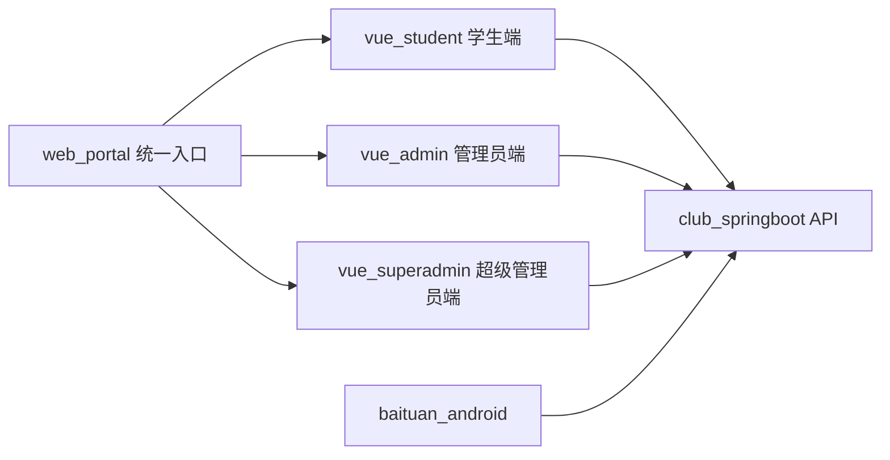

# AI README - 项目规则入口

## 项目总览
数字百团是校园社团管理系统，包含 Spring Boot 后端、统一网页入口、学生/社团管理员/超级管理员三个 Vue 3 网页端，以及 Android 原生端。AI 修改项目时应先确认目标端，再沿用既有分层与目录约定。

## 生成信息
- 生成时间：2026-06-30 15:39
- 生成分支：codex-current-vs-master-diff

## 快速导航

### AI 生成文档（generated/）
- [x] [项目结构](./generated/项目结构.md) - 目录树、模块划分；了解代码组织时使用 (2026-06-30 15:39)
- [x] [技术架构](./generated/技术架构.md) - 分层架构、技术栈；了解技术选型时使用 (2026-06-30 15:39)
- [x] [开发指南](./generated/开发指南.md) - 环境搭建、构建/启动命令；上手时使用 (2026-06-30 15:39)
- [x] [核心流程](./generated/核心流程.md) - 主要业务调用链；理解系统时使用 (2026-06-30 15:39)

### 人工维护文档（manual/）
- [ ] [业务知识](./manual/业务知识.md) - 项目背景、领域术语、业务规则
- [ ] [历史经验](./manual/历史经验.md) - 踩坑记录；写代码前必读

## 使用约定
- 修改后端时优先阅读 [技术架构](./generated/技术架构.md) 和 [核心流程](./generated/核心流程.md)。
- 修改网页端时先判断目标是统一入口 `web_portal`，还是三个业务端之一。
- 修改 Android 端时先阅读 `baituan_android/README.md` 与 Gradle 配置。
- 不确定的业务规则不要补写为事实，使用 `<!-- TODO -->` 标记。
