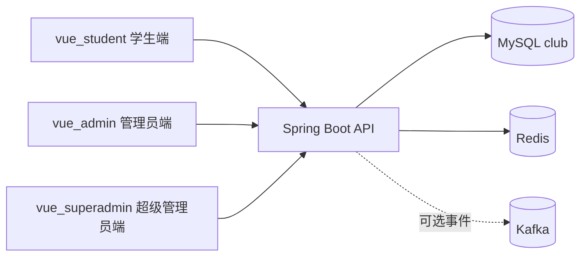

# AI README - 项目规则入口

## 项目总览
数字百团是一个校园社团管理系统，后端由 Spring Boot 提供 REST API，前端分为学生端、社团管理员端和超级管理员端三个 Vue 2 应用，数据主要通过 MySQL、Redis、MyBatis/MyBatis-Plus 和可选 Kafka 组件流转。

## 生成信息
- 生成时间：2026-05-14 17:35
- 生成分支：codex-current-vs-master-diff

## 快速导航
### AI 生成文档（generated/）
- [x] [项目结构](./generated/项目结构.md) - 目录树、模块划分；了解代码组织时使用 (2026-05-14 17:35)
- [x] [技术架构](./generated/技术架构.md) - 分层架构、技术栈；了解技术选型时使用 (2026-05-14 17:35)
- [x] [开发指南](./generated/开发指南.md) - 环境搭建、构建/启动命令；上手时使用 (2026-05-14 17:35)
- [x] [核心流程](./generated/核心流程.md) - 主要业务调用链；理解系统时使用 (2026-05-14 17:35)

### 人工维护文档（manual/）
- [ ] [业务知识](./manual/业务知识.md) - 项目背景、领域术语、业务规则
- [ ] [历史经验](./manual/历史经验.md) - 踩坑记录；写代码前必读
