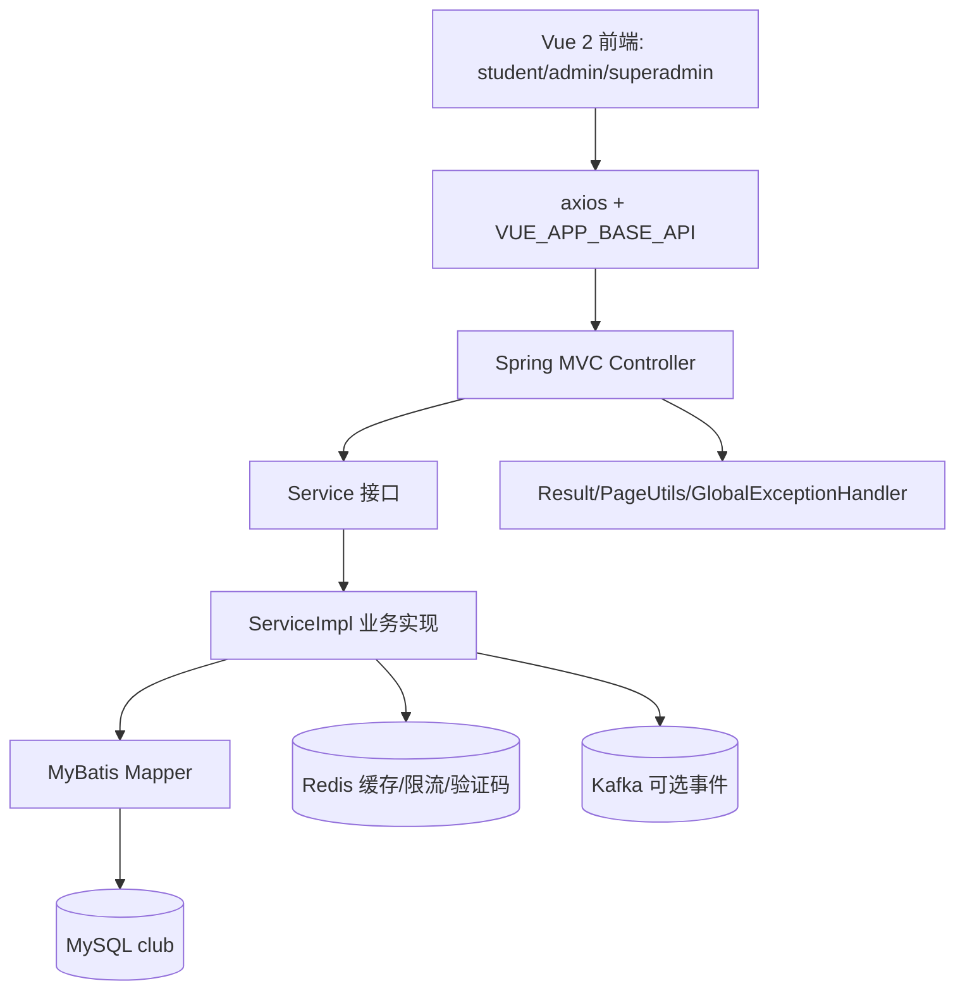

<!-- AI生成，可根据团队规范更新 -->
# 技术架构

## 架构总览

## 分层说明
| 分层 | 职责 | 主要类/文件 |
| --- | --- | --- |
| 前端表现层 | 三个 Vue 2 应用分别承载学生端、管理员端、超级管理员端页面和路由 | `vue_student/src/router/index.js`, `vue_admin/src/router/index.js`, `vue_superadmin/src/router/index.js` |
| 前端请求层 | axios 实例统一读取 `VUE_APP_BASE_API`，带 `X-Token`，按后端 `code === 20000` 判定成功 | `*/src/utils/request.js`, `*/.env.development` |
| HTTP 控制层 | Spring `@RestController` 暴露 `/student`、`/manager`、`/topManager`、`/group`、`/activity`、`/application` 等接口 | `StuController.java`, `ManagerController.java`, `TopManagerController.java`, `GroupController.java`, `ActivityController.java` |
| 业务层 | 处理登录注册、社团查询/申请、活动报名/审批、缓存失效、验证码等业务动作 | `StuServiceImpl.java`, `GroupServiceImpl.java`, `ActivityServiceImpl.java` |
| 数据访问层 | Mapper 接口和 XML 映射负责 SQL 查询、插入、更新 | `mapper/*.java`, `resources/mapper/*.xml` |
| 横切能力 | 限流、重复提交限制、全局异常、日志、文件上传、JWT、密码处理 | `aop/`, `exception/`, `utils/JwtUtils.java`, `utils/PasswordUtil.java` |
| 基础设施 | MySQL、Redis、Kafka、Logback、静态资源与上传目录配置 | `application.properties`, `logback-spring.xml`, `activity_apply.lua` |

## 技术栈
| 类目 | 技术 | 版本 | 用途 |
| --- | --- | --- | --- |
| 语言/运行时 | Java | 16 | 后端运行与编译，见 `pom.xml` 的 `java.version` / `maven.compiler.release` |
| 主框架 | Spring Boot | 2.5.3 | Web、Security、JDBC、Redis、Thymeleaf 等后端能力 |
| ORM/SQL | MyBatis-Plus | 3.4.2 | Mapper 扫描、XML SQL 映射、BaseMapper |
| 数据库 | MySQL Connector/J | 8.0.28 | 连接 `jdbc:mysql://localhost:3306/club` |
| 缓存 | Spring Data Redis + Jedis pool | Spring Boot 管理 | 缓存、验证码、限流和报名防重 |
| 消息 | Spring Kafka | 2.8.1 | 可选事件发送、缓存失效兜底、导入消费者 |
| 前端框架 | Vue | 2.6.10 | 三个前端应用 |
| UI | Element UI | 2.13.2 | 页面组件 |
| 前端构建 | Vue CLI Service | 4.4.x | `npm run dev`, `npm run build:prod` |
| 前端请求 | axios | `0.18.1` / `^0.21.4` | HTTP 请求封装 |
| 测试框架 | Spring Boot Test / JUnit / Jest | 由依赖声明 | 后端单测、前端单测 |
| 构建工具 | Maven / npm | Maven 插件、npm scripts | 后端构建测试、前端构建启动 |
