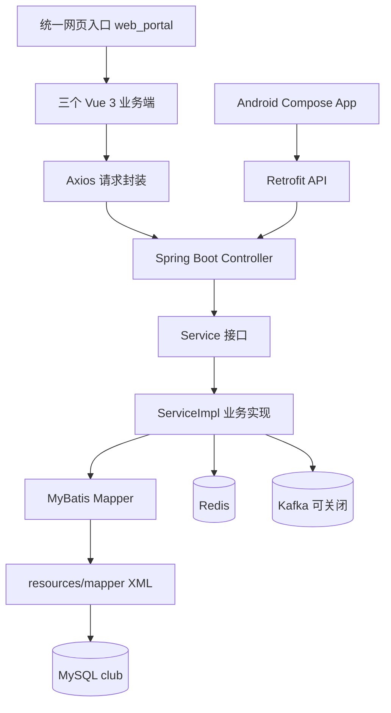

<!-- AI生成，可根据团队规范更新 -->
# 技术架构

## 架构总览

## 分层说明
| 分层 | 职责 | 主要类/文件 |
| --- | --- | --- |
| 统一入口层 | 选择用户身份并跳转到对应网页端登录页 | `web_portal/src/App.vue` |
| 网页表现层 | 展示三类用户页面，管理路由、状态、请求和表单交互 | `vue_student/src/`、`vue_admin/src/`、`vue_superadmin/src/` |
| Android 表现层 | Compose 页面、导航、ViewModel 与状态展示 | `baituan_android/app/src/main/java/com/minislother/baituan/ui/` |
| Android 数据层 | Repository、TokenStore、Retrofit API、网络解析 | `data/`、`core/auth/`、`core/network/`、`di/NetworkModule.kt` |
| 后端入口层 | 接收 HTTP 请求，返回统一响应 | `controller/` |
| 后端业务层 | 编排业务逻辑、状态变更、鉴权辅助、文件处理 | `service/`、`service/impl/`、`utils/` |
| 后端数据层 | MyBatis Mapper 接口和 XML SQL | `mapper/`、`src/main/resources/mapper/` |
| 后端基础设施 | Spring Security、JWT、全局异常、配置、Redis、Kafka | `config/`、`exception/`、`application.properties` |

## 技术栈
| 类目 | 技术 | 版本 | 用途 |
| --- | --- | --- | --- |
| 后端语言 | Java | Maven 编译目标 16，建议本地 JDK 17 | 后端开发与运行 |
| 后端框架 | Spring Boot | 2.5.3 | REST API、配置、Actuator |
| 鉴权 | Spring Security + JWT | `jjwt` 0.9.1 | 登录认证与请求过滤 |
| ORM | MyBatis-Plus / MyBatis XML | MyBatis-Plus 3.4.2 | 数据访问 |
| 数据库 | MySQL | 驱动 8.0.28 | 核心业务数据 |
| 缓存 | Redis | Spring Data Redis | 缓存与限流相关能力 |
| 消息队列 | Kafka | spring-kafka 2.8.1 | 活动、社团、用户导入等主题；可通过配置关闭 |
| Excel | Apache POI | 5.2.5 | 批量导入导出 |
| 网页框架 | Vue | 3.4+ / 3.5+ | 统一入口与三端业务前端 |
| 网页 UI | Element Plus | 2.x | 三端后台类界面组件 |
| 网页构建 | Vue CLI | 5.x | 开发服务与生产构建 |
| 入口页图标 | `@lucide/vue` | 1.x | 统一入口图标 |
| Android | Kotlin + Jetpack Compose | compileSdk 35 | 原生移动端 |
| Android 网络 | Retrofit + OkHttp + Gson | 2.11 / 4.12 / 2.11 | API 请求与 JSON 解析 |
| Android DI | Hilt | 2.52 | 依赖注入 |
| Android 本地存储 | DataStore | 1.1.1 | Token 与身份保存 |
| 测试 | JUnit / Mockito / JaCoCo / Vue Test Utils / AndroidX Test | 见各模块配置 | 单元测试与覆盖率 |

## 关键配置
| 文件 | 说明 |
| --- | --- |
| `club_springboot/src/main/resources/application.properties` | 后端端口、MySQL、Redis、Kafka、上传、日志、Actuator 配置 |
| `club_springboot/src/main/resources/application-prod.properties` | 生产环境配置覆盖 |
| `web_portal/vue.config.js` | 统一入口默认端口 `9527` 与构建配置 |
| `vue_student/vue.config.js` | 学生端默认端口 `9528` |
| `vue_admin/vue.config.js` | 管理员端默认端口 `9531` |
| `vue_superadmin/vue.config.js` | 超级管理员端默认端口 `9532` |
| `baituan_android/app/build.gradle.kts` | Android SDK、签名、BuildConfig 字符串、依赖配置 |

## 约束
- 后端优先沿用 Controller -> Service -> ServiceImpl -> Mapper -> XML。
- 前端新增公共能力时优先考虑 `frontend-shared/`，不要复制三份逻辑。
- 统一入口只负责跳转，不应引入三端业务登录态。
- Android 网络基础地址由 Gradle 属性 `BAITUAN_DEBUG_BASE_URL`、`BAITUAN_RELEASE_BASE_URL` 注入。
