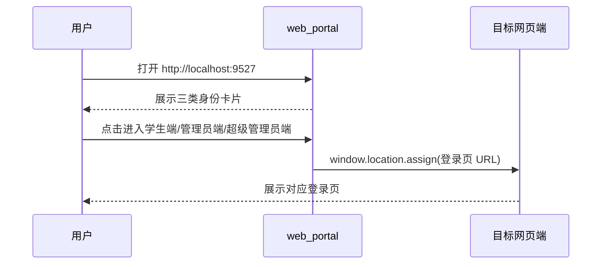
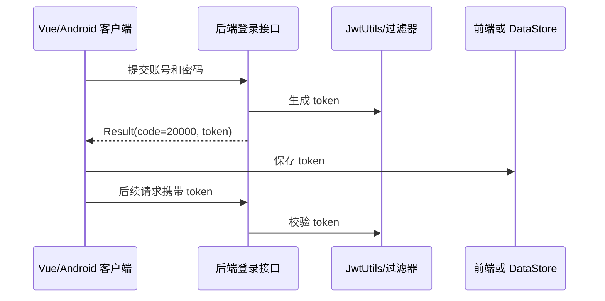
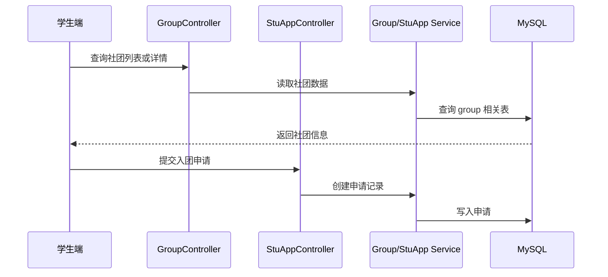
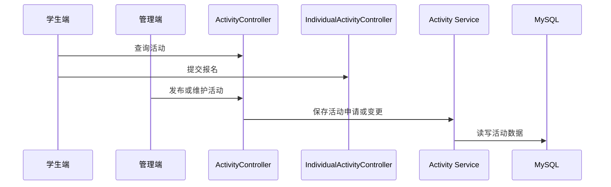

<!-- AI生成，可根据团队规范更新 -->
# 核心流程

> 提示：以下流程由 AI 从代码推断而来，请用户确认 P0/P1 是否就是团队认知中的核心。

## 流程清单
| 优先级 | 流程名 | 入口 | 备注 |
| --- | --- | --- | --- |
| P0 | 网页端身份选择与跳转 | `web_portal/src/App.vue` | 学生、管理员、超级管理员从统一入口进入 |
| P0 | 用户登录与 JWT 鉴权 | `vue_*/src/views/login/index.vue`、后端登录 Controller | 前端按 `code === 20000` 判定成功，后端由 Spring Security/JWT 保护 |
| P0 | 学生浏览社团并申请加入 | `vue_student/src/views/dashboard/`、`GroupController`、`StuAppController` | 涉及社团列表、详情、申请记录 |
| P0 | 活动浏览与报名 | `vue_student/src/views/activity/`、`ActivityController`、`IndividualActivityController` | 涉及活动详情和报名 |
| P1 | 社团管理员处理申请与成员 | `vue_admin/src/views/seeapplication/`、`ManagerController`、`IndividualGroupController` | 管理员端核心工作台 |
| P1 | 超级管理员审批与批量导入 | `vue_superadmin/src/views/`、`TopManagerController`、`InspectionController` | 平台级管理 |
| P1 | Android 身份选择与移动端访问 | `RoleSelectionScreen.kt`、`BaituanApp.kt`、`BaituanApi.kt` | 通过 Retrofit 访问同一后端 |

## 流程 1：网页端统一入口跳转

### 调用链
1. `web_portal/src/main.js` 创建 Vue 应用。
2. `web_portal/src/App.vue` 渲染 `roles` 数组。
3. `goToRole(role)` 使用 `window.location.assign(role.url)` 跳转。
4. 默认目标为 `9533/#/login`、`9531/#/login`、`9532/#/login`。

### 关键分支
- 可通过 `VUE_APP_STUDENT_URL`、`VUE_APP_ADMIN_URL`、`VUE_APP_SUPERADMIN_URL` 覆盖跳转地址。
- 统一入口不读写三端 token，避免登录态串扰。

## 流程 2：登录与请求鉴权

### 调用链
1. 网页端：`src/views/login/index.vue` 调用 `src/api/user.js`。
2. 网页端：`src/utils/request.js` 统一封装 Axios。
3. 后端：学生、管理员、超级管理员登录由对应 Controller 和 Service 处理。
4. 后端：`config/JwtAuthenticationFilter.java`、`utils/JwtUtils.java` 参与鉴权。
5. Android：`AuthRepository.kt` 调用 `BaituanApi.kt`，`TokenStore.kt` 保存 token。

### 关键分支
- 前端成功判断依赖统一响应 `code === 20000`。
- 后端未处理异常进入 `GlobalExceptionHandler`。

## 流程 3：学生申请加入社团

### 调用链
1. `vue_student/src/views/dashboard/`、`showgroupdetails/`、`application/` 组织页面交互。
2. `vue_student/src/api/group.js` 调用社团相关 API。
3. `GroupController`、`StuAppController` 接收请求。
4. `GroupServiceImpl`、`StuAppServiceImpl` 处理业务。
5. `GroupMapper.xml`、`StuAppMapper.xml` 执行 SQL。

### 关键分支
- 具体申请状态流转需以数据库字段和 Service 实现为准；业务含义建议在 `manual/业务知识.md` 补充。

## 流程 4：活动报名与审批

### 调用链
1. 学生端活动页面位于 `vue_student/src/views/activity/`、`activityapplication/`。
2. 管理员端活动页面位于 `vue_admin/src/views/groupactivity/`。
3. 超级管理员活动审批页面位于 `vue_superadmin/src/views/activity/`。
4. 后端入口包括 `ActivityController`、`IndividualActivityController`。
5. 数据访问包括 `ActivityMapper.xml`、`IndividualActivityMapper.xml`。

### 关键分支
- Kafka 相关主题在 `application.properties` 中存在，但业务监听默认关闭，启用前需确认环境配置。
