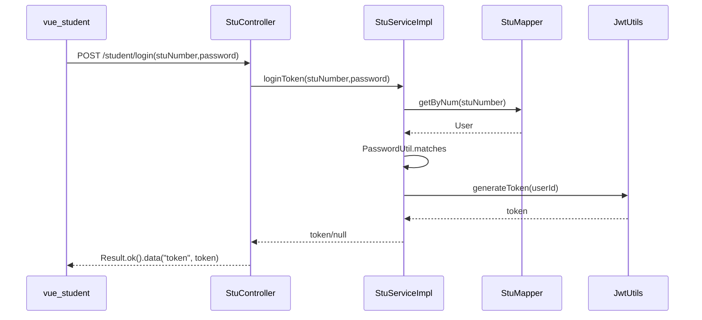
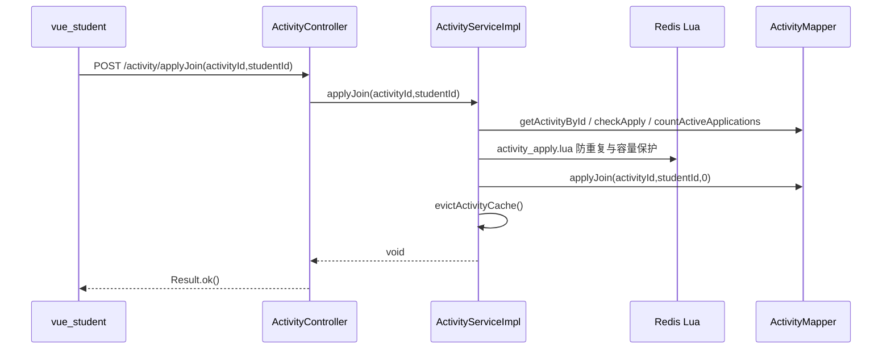
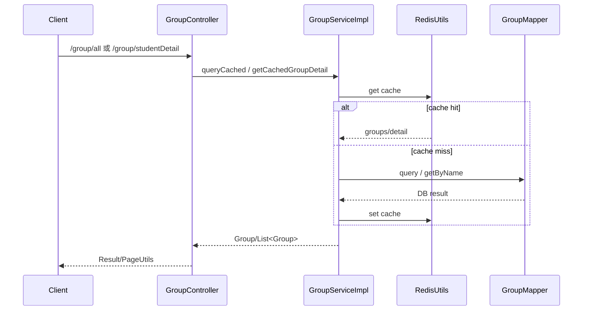

<!-- AI生成，可根据团队规范更新 -->
# 核心流程
> 提示：以下流程由 AI 从代码推断而来，请用户确认 P0/P1 是否就是团队认知中的核心。

## 流程清单
| 优先级 | 流程名 | 入口 | 备注 |
| --- | --- | --- | --- |
| P0 | 学生登录并获取 token | `POST /student/login` -> `StuController.login` | `StuServiceImpl.loginToken` 校验密码并通过 `JwtUtils.generateToken` 生成 token |
| P0 | 学生报名活动 | `POST /activity/applyJoin` -> `ActivityController.applyJoin` | `ActivityServiceImpl.applyJoin` 使用 DB 检查 + Redis Lua 防重复/控容量 |
| P1 | 社团列表与详情查询 | `/group/all`, `/group/studentDetail` | `GroupServiceImpl` 使用 Redis 缓存和逻辑过期重建详情 |
| P1 | 社团/活动申请审核 | `/group/accept`, `/group/reject`, `/activity/accept`, `/activity/reject` | 审核后清理缓存，部分逻辑发送 Kafka 缓存事件 |

## 流程 1：学生登录

### 调用链
1. `vue_student/src/store/modules/user.js` 与相关登录页面通过 axios 访问学生登录接口。
2. `club_springboot/src/main/java/com/chinahitech/shop/controller/StuController.java:login`
3. `club_springboot/src/main/java/com/chinahitech/shop/service/impl/StuServiceImpl.java:loginToken`
4. `StuServiceImpl.login` -> `StuMapper.getByNum`
5. `PasswordUtil.matches` -> `JwtUtils.generateToken`

### 关键分支
- 用户不存在时，`StuServiceImpl.login` 抛出 `EntityNotFoundException`。
- 密码不匹配时，当前代码将 `User.password` 置为 `null`，`loginToken` 返回 `null`。
- Controller 对 `null` token 返回 `Result.error()`。

## 流程 2：学生报名活动

### 调用链
1. `club_springboot/src/main/java/com/chinahitech/shop/controller/ActivityController.java:applyJoin`
2. `club_springboot/src/main/java/com/chinahitech/shop/service/impl/ActivityServiceImpl.java:applyJoin`
3. `ActivityMapper.getActivityById`, `checkApply`, `countActiveApplications`
4. `ActivityServiceImpl.tryApplyGuard` -> `activity_apply.lua`
5. `ActivityMapper.applyJoin`
6. `ActivityServiceImpl.evictActivityCache`

### 关键分支
- `activityId` 或 `studentId` 为空时抛出 `BusinessException("PARAM_ERROR", ...)`。
- 活动不存在、重复报名、报名人数已满分别抛出 `BusinessException`。
- Redis guard 执行失败时返回 `null`，仍依赖数据库检查与插入路径。
- 数据库插入异常且 Redis guard 已写入时，`rollbackApplyGuard` 尝试回滚 Redis 计数。

## 流程 3：社团列表与详情缓存

### 调用链
1. `vue_student/src/api/group.js:getGroups` -> `/group/all`
2. `club_springboot/src/main/java/com/chinahitech/shop/controller/GroupController.java:getAll`
3. `GroupServiceImpl.queryCached`
4. `RedisUtils.get/set`
5. `GroupMapper.query`

### 关键分支
- 列表缓存 key 为 `group:all:<searchInfo>`，TTL 300 秒。
- 详情缓存使用 `CacheData` 和逻辑过期时间，过期后尝试获取 `lock:group:detail:<groupName>` 并异步重建。
- 写操作如 `insert`、`updateDescription`、审核通过/拒绝会调用 `evictGroupCache`。
