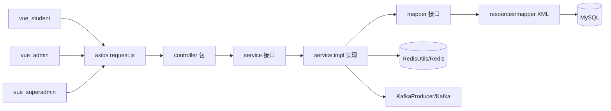

<!-- AI生成，可根据团队规范更新 -->
# 项目结构

## 目录树
```text
项目根/
|-- AGENTS.md
|-- .codex/rules/ai-readme/
|   |-- README.md
|   |-- generated/
|   `-- manual/
|-- club_springboot/              # Spring Boot 后端
|   |-- pom.xml
|   |-- src/main/java/com/chinahitech/shop/
|   |   |-- ShopApplication.java
|   |   |-- controller/
|   |   |-- service/
|   |   |-- service/impl/
|   |   |-- mapper/
|   |   |-- bean/
|   |   |-- config/
|   |   |-- exception/
|   |   |-- aop/
|   |   |-- mq/
|   |   `-- utils/
|   |-- src/main/resources/
|   |   |-- application.properties
|   |   |-- mapper/
|   |   |-- activity_apply.lua
|   |   `-- limiter.lua
|   `-- src/test/java/com/chinahitech/shop/
|-- vue_student/                  # 学生端 Vue 2 应用
|-- vue_admin/                    # 社团管理员端 Vue 2 应用
|-- vue_superadmin/               # 超级管理员端 Vue 2 应用
|-- rules/                        # 项目级规则文档
|-- club_finalversion.sql
|-- CODE_REVIEW_RULES.md
|-- CODE_REVIEW_REPORT.md
`-- current-vs-master.diff
```

## 模块职责
| 目录 | 职责 | 关键文件 |
| --- | --- | --- |
| `club_springboot/` | 后端 API、业务服务、数据库访问、缓存、限流、消息相关逻辑 | `pom.xml`, `ShopApplication.java`, `application.properties` |
| `club_springboot/src/main/java/com/chinahitech/shop/controller/` | 暴露学生、管理员、超级管理员、社团、活动、年检、天气等 HTTP 接口 | `StuController.java`, `ManagerController.java`, `TopManagerController.java`, `GroupController.java`, `ActivityController.java` |
| `club_springboot/src/main/java/com/chinahitech/shop/service/impl/` | 业务实现，包含登录注册、社团/活动查询、申请审核、缓存重建等 | `StuServiceImpl.java`, `GroupServiceImpl.java`, `ActivityServiceImpl.java` |
| `club_springboot/src/main/java/com/chinahitech/shop/mapper/` | MyBatis/MyBatis-Plus Mapper 接口 | `ActivityMapper.java`, `GroupMapper.java`, `StuMapper.java` |
| `club_springboot/src/main/resources/mapper/` | MyBatis XML SQL 映射 | `ActivityMapper.xml`, `GroupMapper.xml`, `StuMapper.xml` |
| `club_springboot/src/main/java/com/chinahitech/shop/aop/` | 限流、重复请求限制、日志切面 | `RepeatLimit.java`, `RateLimiterAspect.java`, `LogAspect.java` |
| `club_springboot/src/main/java/com/chinahitech/shop/mq/` | Kafka 生产者、消费者和导入/缓存事件处理 | `KafkaProducer.java`, `UserImportKafkaConsumer.java`, `GroupKafkaConsumer.java` |
| `vue_student/` | 学生端页面：社团列表、活动列表、申请、个人信息、我的社团/申请 | `src/router/index.js`, `src/api/group.js`, `src/api/activity.js` |
| `vue_admin/` | 社团管理员端页面：申请列表、社团管理、成员管理、社团活动 | `src/router/index.js`, `src/api/activities.js`, `src/api/manage.js` |
| `vue_superadmin/` | 超级管理员端页面：学生/社团管理、活动审批、批量添加、数据展示 | `src/router/index.js`, `src/views/add/index.vue` |

## 模块依赖关系

