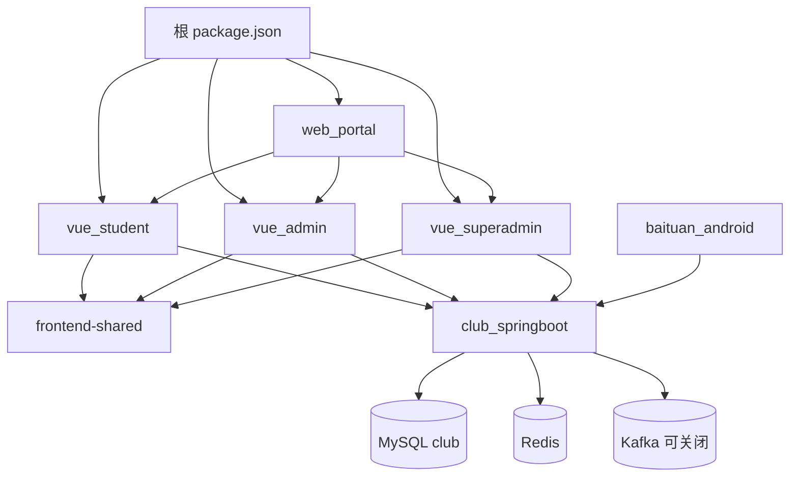

<!-- AI生成，可根据团队规范更新 -->
# 项目结构

## 目录树
```text
项目根/
|-- AGENTS.md
|-- README.md
|-- package.json
|-- club_finalversion.sql
|-- club_springboot/
|   |-- pom.xml
|   |-- src/main/java/com/chinahitech/shop/
|   |   |-- ShopApplication.java
|   |   |-- controller/
|   |   |-- service/
|   |   |-- service/impl/
|   |   |-- mapper/
|   |   |-- config/
|   |   |-- exception/
|   |   `-- utils/
|   `-- src/main/resources/
|       |-- application.properties
|       |-- application-prod.properties
|       `-- mapper/
|-- web_portal/
|   |-- package.json
|   |-- vue.config.js
|   |-- public/index.html
|   `-- src/
|       |-- App.vue
|       |-- main.js
|       `-- styles.css
|-- vue_student/
|-- vue_admin/
|-- vue_superadmin/
|-- frontend-shared/
|-- baituan_android/
|   |-- settings.gradle.kts
|   `-- app/src/main/java/com/minislother/baituan/
|-- deploy/
`-- .codex/rules/
```

## 模块职责
| 目录 | 职责 | 关键文件 |
| --- | --- | --- |
| `club_springboot/` | Spring Boot 后端，负责登录鉴权、社团、活动、申请、审核、上传、批量导入等接口 | `ShopApplication.java`、`controller/`、`service/impl/`、`mapper/`、`resources/mapper/` |
| `web_portal/` | 网页端统一身份入口，选择学生、管理员或超级管理员后跳转到对应 Web 端 | `src/App.vue`、`src/styles.css`、`vue.config.js` |
| `vue_student/` | 学生网页端，包含社团广场、活动中心、申请、个人信息等页面 | `src/router/index.js`、`src/views/`、`src/api/` |
| `vue_admin/` | 社团管理员网页端，包含入团申请、成员、社团资料、社团活动管理 | `src/router/index.js`、`src/views/`、`src/api/` |
| `vue_superadmin/` | 超级管理员网页端，包含学生、社团、活动审批、批量导入、数据总览 | `src/router/index.js`、`src/views/`、`src/api/` |
| `frontend-shared/` | 三个业务网页端共享的前端工具模块 | `package.json`、`src/` |
| `baituan_android/` | Android 原生端，支持身份选择、登录、学生功能和管理工作台 | `MainActivity.kt`、`ui/`、`data/`、`core/network/` |
| `deploy/` | 生产部署说明与环境变量示例 | `production.md`、`env/` |
| `.codex/rules/` | Codex 规则、报告模板、AI README 文档 | `CODE_REVIEW_RULES.md`、`TEST_RULES.md`、`TEST_ACC_RULES.md` |

## 模块依赖关系


## 结构注意事项
- `web_portal` 是新增统一入口应用，不承载业务状态，只做身份选择和跳转。
- 三个业务网页端仍是独立 Vue 3 应用，默认端口分别为学生端 `9528`、管理员端 `9531`、超级管理员端 `9532`。
- 后端 MyBatis Java Mapper 与 XML Mapper 分离，XML 位于 `club_springboot/src/main/resources/mapper/`。
- `manual/` 下文档由人工维护，已存在时不要覆盖。
